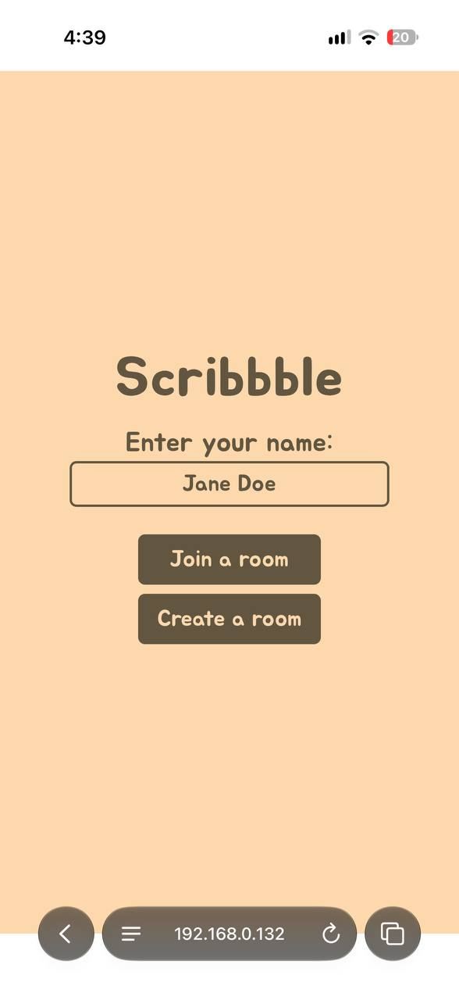
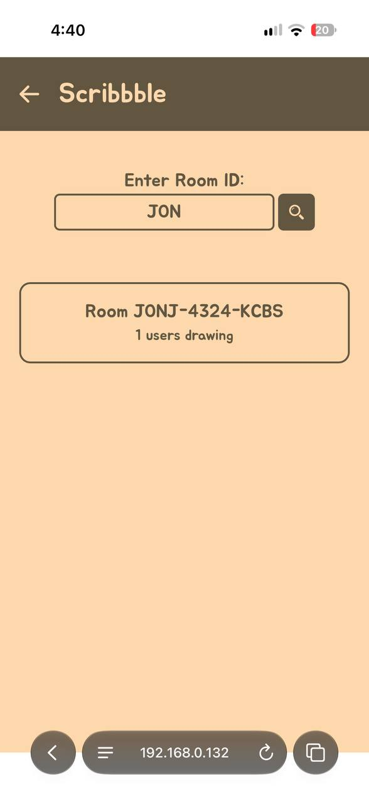
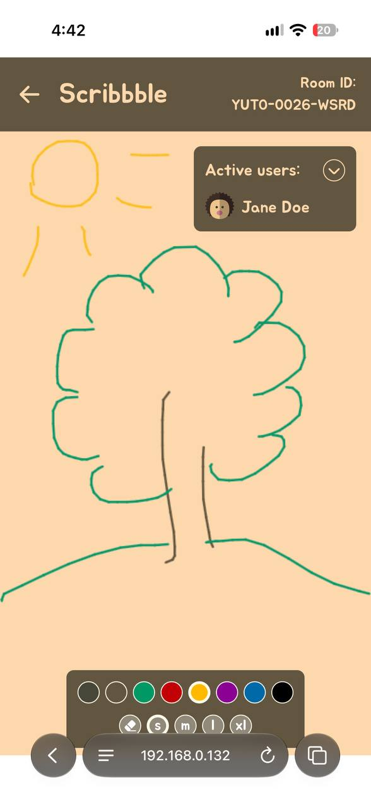
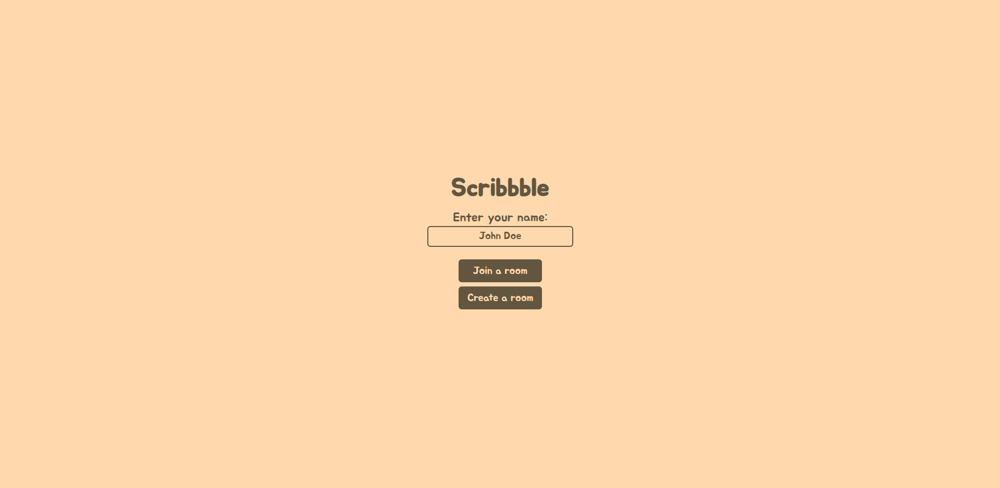
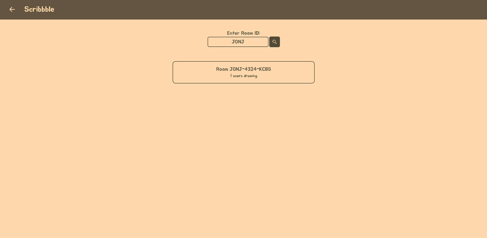
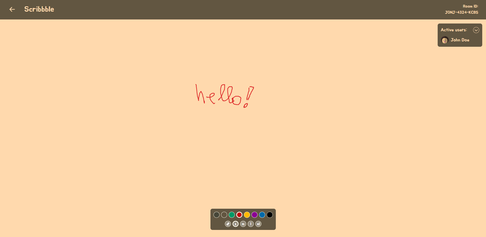

## 📋 Scribbble

A Paint-inspired collaborative drawing web application that allows multiple users to draw together on a shared canvas in real time. Users can create drawings, interact with other participants, and watch their contributions appear instantly.

## ⚒️ Technologies

> #### Front-End: React, TypeScript, React Router, Axios, Socket.IO, Zustand, (Framer) Motion, TailwindCSS, Vite

> #### Back-End: Node.js, TypeScript, Express, Socket.IO

## 💫 Functionality

- **User identification:** Enter a display name upon visiting the application
- **Room Management**: Create a new drawing room or search for and join an existing one
- **Interactive Drawing**: Draw freely using different colors and brush sizes
- **Real-Time Collaboration:** Draw together with other participants in the same room.

## 🤸 Running the Project

1. Make sure you have Node.js installed on your system;
2. Clone the <a href="https://github.com/nadobrranichh/scribbble-backend">backend</a> repository;
3. In the directory of the backend repository, create a `.env` file and add this key:
   ```env
   FRONTEND_URL="http://localhost:5173"
   PORT=3000
   ```
   Adjust PORT to the port you'd like;
4. Open a terminal in the backend directory and run these commands:
   ```bash
   npm install                 # installs npm dependencies
   npm run build               # prepares the project for startup
   npm run dev                 # starts the backend on http://localhost:PORT
   ```
   Don't close the terminal;
5. Clone the <a href="https://github.com/nadobrranichh/scribbble">frontend</a> repository;
6. In the directory of the frontend repository, create a `.env` file and add this key:
   ```env
   VITE_BACKEND_URL=http://localhost:[PORT]
   ```
   Instead of `[PORT]`, set the port value from your backend `.env`;
7. Open a terminal in the frontend directory and run these commands:
   ```bash
   npm install                 # installs npm dependencies
   npm run dev                 # starts the frontend on http://localhost:5173
   ```
8. Visit `http://localhost:5173` in your browser.

## Preview

### Mobile:

<p style="display: flex; gap: 1rem">
  
  
  
</p>

### Desktop:

<p style="display: flex; flex-direction: column; gap: 1rem">
  
  
  
</p>
